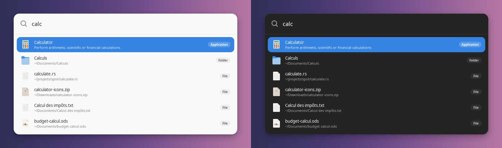
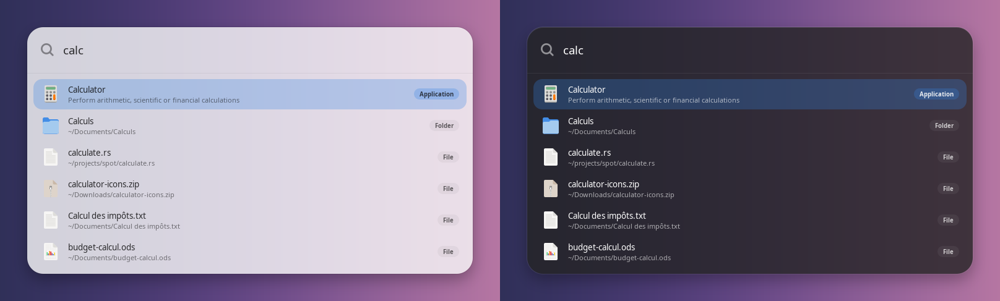
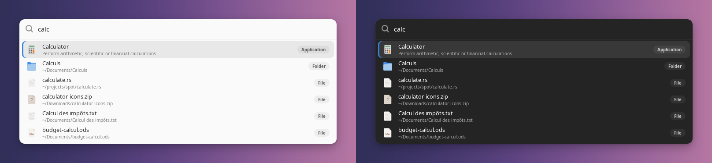

# spot

Application and file launcher for Linux, in Rust + GTK4 / libadwaita. Press a shortcut, type, press Enter: the window is gone as soon as you launch something. Think Raycast or Spotlight, for GNOME and other GTK4 desktops.



[Features](#features) · [Install](#install) · [First run](#first-run) · [Using spot](#using-spot) · [Prefixes](#prefixes) · [Settings](#settings) · [Appearance](#appearance) · [Compatibility](#compatibility) · [Troubleshooting](#troubleshooting) · [How it works](#how-it-works) · [Development](#development)

## Features

- **Applications**, matched on name, keywords and executable. The ones you launch often come first.
- **Files** in your home directory, found as you type.
- **Built-in calculator**: decimal/hex input, functions and clipboard actions, independent of GNOME Calculator.
- **GNOME Activities search providers**: Settings panels, Nautilus files and other installed providers.
- **Commands**: if nothing matches, Enter runs what you typed.
- **Web search**: if nothing matches, a last row hands what you typed to your browser, which searches with its own engine.
- **Prefixes**: `!htop` runs in a terminal, `search: rust` searches in your browser. See [Prefixes](#prefixes).
- **System actions**: lock, suspend, log out, restart, shut down.
- **Instant**: the first launch stays in the background; opening the window takes about 10 ms.
- **Three styles**, light and dark, following the accent colour of your desktop. See [Appearance](#appearance).
- English and French, following the system language.

## Install

| Your system | Go to |
|---|---|
| Arch Linux | [Arch](#arch-linux) |
| Ubuntu 24.04+, Linux Mint 22+, Debian 13 | [Ubuntu, Linux Mint, Debian](#ubuntu-linux-mint-debian) |
| Fedora | [Fedora](#fedora) |
| Anything else with GTK 4.12+ | [Other distributions](#other-distributions) |

On Arch there is a prebuilt package; everywhere else spot is compiled on your machine. Debian 12, Ubuntu 22.04, Linux Mint 21 and older cannot run it, their GTK is older than 4.12. macOS and Windows are not supported, see [Compatibility](#compatibility).

### Arch Linux

Every release ships a ready-to-install package (no compiler needed). It installs as `spot-launcher`, which pacman then tracks like any other. The package is not signed, so download it first: given a URL, pacman looks for a `.sig` file and warns when there is none.

```bash
curl -LO https://github.com/alarboulletmarin/spot/releases/latest/download/spot-launcher-x86_64.pkg.tar.zst
sudo pacman -U ./spot-launcher-x86_64.pkg.tar.zst
```

To follow `main` instead, build the development package from a checkout (needs `cargo`, it conflicts with `spot-launcher`):

```bash
git clone https://github.com/alarboulletmarin/spot.git
cd spot/aur/spot-launcher-git
makepkg -si
```

Or build the latest tagged release yourself with `makepkg -si` from the repository root. Not on the AUR yet.

Optional: `plocate`, for file search.

### Ubuntu, Linux Mint, Debian

1. Install the build tools and libraries:

   ```bash
   sudo apt install build-essential pkg-config libgtk-4-dev libadwaita-1-dev libsoup-3.0-dev gettext plocate
   ```

2. Install Rust **1.92 or newer** with [rustup](https://rustup.rs). The `cargo` from apt is too old (Ubuntu 24.04, hence Linux Mint 22, stops at 1.91). Check with `rustc --version`.

3. Build and install:

   ```bash
   git clone https://github.com/alarboulletmarin/spot.git
   cd spot
   make
   sudo make install
   ```

Build and install tested on Ubuntu 24.04.

### Fedora

Same steps as above, with these packages (names not tested):

```bash
sudo dnf install gcc pkgconf-pkg-config gtk4-devel libadwaita-devel libsoup3-devel gettext plocate
```

Check `rustc --version`: you need 1.92 or newer, use [rustup](https://rustup.rs) if yours is older.

### Other distributions

You need GTK 4.12+, libadwaita 1 and libsoup 3 with their development files, `gettext` (for `msgfmt`), `plocate` for file search, and Rust 1.92+. Then:

```bash
make                    # cargo build --release --locked
sudo make install       # PREFIX=/usr/local by default, PREFIX=/usr for a system-wide install
```

### Upgrading

| Installed with | Upgrade |
|---|---|
| Arch, prebuilt package | run the two commands above again |
| Arch, `spot-launcher-git` | `git pull` then `makepkg -si` in `aur/spot-launcher-git` |
| `make install` | `git pull`, then `make` and `sudo make install` |

If `spot --version` still shows an old number after upgrading, a copy installed earlier with `make install` is ahead of the package in your `PATH`: `type -a spot` lists them. Remove it with `sudo make uninstall` (same `PREFIX` as the install, `/usr/local` by default).

Then restart the background process so the new binary runs:

```bash
spot --quit && spot --daemon &
```

## First run

Three things to do once after installing.

**1. Start the background service.** Log out and back in, or start it by hand:

```bash
spot --daemon &
```

**2. Set a keyboard shortcut** that runs the command `spot`. An application cannot grab a global shortcut under Wayland, so your desktop has to do it. On GNOME: Settings → Keyboard → Custom Shortcuts → add `spot`, for example on `Super + Space`. On KDE, Hyprland, Sway…: bind the same command in your desktop or compositor.

**3. Centre the window (Wayland only).** A window cannot position itself under Wayland; the compositor places it. On GNOME:

```bash
gsettings set org.gnome.mutter center-new-windows true
```

On other compositors, add a rule that centres floating windows with the id `dev.andrea.Spot`.

## Using spot

Press your shortcut and start typing.

| Key | Action |
|---|---|
| your shortcut | open, or close when already open |
| `↑` `↓`, `Ctrl + P` `Ctrl + N`, `Ctrl + K` `Ctrl + J` | navigate |
| `Page Up` `Page Down` | navigate a page at a time |
| `Enter` | launch or open |
| `Ctrl + Enter` | the second action of the result: the folder containing the file… |
| `Alt + 1` … `Alt + 9` | launch the result with that number; the numbers show while `Alt` is held |
| `Ctrl + ,` | spot's settings |
| `Esc` | close, or leave the settings |

The line under the results says what `Enter` and `Ctrl + Enter` do to the selected one. Every key but `Enter` can be changed, see [Keys](#keys).

The window also closes as soon as it loses focus.

| Type | You get |
|---|---|
| `calc` | the Calculator application if you have one, plus files and folders with `calc` in their name |
| `report` | files in your home directory whose name contains it (from 3 characters) |
| `lock`, `shut` | the matching system action |
| `notify-send hello` | when nothing matches and the first word is a program on your `PATH`: Enter runs the line in the background, without a terminal |
| `zzzqq` | nothing matches: after a third of a second, a last row “Search for…” hands the text to your browser. Below the command row, if there is one |
| `!git status` | a prefix: the command runs in a terminal, see [Prefixes](#prefixes) |
| `search: rust gtk4` | a prefix: your browser searches |
| `>`, or `theme`, `settings`, `shortcuts` | spot's own settings, see [Settings](#settings) |

## Prefixes

A prefix turns what you type into an instruction. While one is there, spot searches for nothing else. Spot chooses neither a browser nor a terminal nor a search engine: it uses the ones your system and you have set.

| Type | Enter | Ctrl + Enter |
|---|---|---|
| `!git status` | runs the command in a terminal, which stays open afterwards | the same, but the terminal closes when the command ends |
| `search: rust gtk4` | your default browser searches for it, with its own search engine | |
| `https://example.com` or `www.example.com` | opens the address in your default browser | |
| `>` | lists spot's settings and shortcuts, see [Settings](#settings) | |

The space after the colon is optional (`search:rust`), and so is the case.

**Terminal commands.** `!` runs your shell (`$SHELL`) in your home directory, as an interactive shell, so your aliases and your `PATH` apply. The terminal is the first one found among: `xdg-terminal-exec`, `$TERMINAL`, the default terminal set in GNOME, `x-terminal-emulator`, then the usual ones (GNOME Terminal, Ptyxis, Console, Konsole, Xfce Terminal, Alacritty, kitty, foot, WezTerm, xterm…). The way each is told to run a program was checked on xterm, Xfce Terminal, Terminator, MATE Terminal, LXTerminal, Tilix and Console; for GNOME Terminal, kitty, Alacritty and foot it follows their documentation; Konsole, Ptyxis and WezTerm are untested.

**Web searches.** `search:`, and the last row offered when nothing matches, start your default browser (the one your system has for `https`: GNOME Settings → Default Apps, or `xdg-settings get default-web-browser`) and hand it the words. The browser searches with the search engine you set up in it; spot never picks one. Browsers are not all asked the same way:

| Browser | Asked with |
|---|---|
| Firefox and its forks (LibreWolf, Floorp, Waterfox, IceCat, Zen), GNOME Web | `--search words` |
| Chromium and its derivatives (Chrome, Chromium, Brave, Edge, Vivaldi) | an argument `? words`, which Chromium reads as a search |
| any other | the words alone, and it does what it does with them |

This comes from the sources of Firefox, Chromium and GNOME Web, where both forms are handled; the forks are assumed to keep them, and none of the real browsers was run.

To use something else than the browser's own search, there is nothing to configure in spot: set the engine in your browser.

The terminal can be named in `~/.config/spot/spot.conf`; without it, spot picks the default one as described above. The file is watched, so there is nothing to restart.

```ini
# The terminal for `!`, then the argument that introduces the program
[Terminal]
Command=alacritty -e
```

## Matching and completion

`vsc` finds Visual Studio Code and `gt` finds GNOME Terminal. `chorme`, `firfox` and `calandar` can find Chrome, Firefox and Calendar. Matched title characters are bold, including with compact/mono styles and palettes. Typo matches highlight only the exact common prefix.

When the first selected result is an application whose name starts with the typed query, the remaining name appears in grey. **Tab** or **Right**, at the end of the entry without a selection, accepts it. **Enter always activates the selected row**. Prefixes, addresses, the settings palette, mid-entry cursors and non-prefix fuzzy matches have no completion. An explicit user key binding takes precedence over a default completion key.

```ini
[Keys]
Complete=Tab;Right
# Next=Tab overrides Tab completion; Right still completes.
```


## Calculator

Calculations appear synchronously above applications, without a GNOME Calculator installation. Supported syntax: decimal `.` or `,`, `0x` hexadecimal and `0b` binary input, `+ - * / % ^`, `× ÷`, parentheses, unary signs, `pi`, `e`, and `sqrt sin cos tan ln log abs`. Powers associate to the right (`2^3^2 = 512`), and `-2^2 = -4`; trigonometric arguments use radians. Bare numbers and constants remain searches. Invalid or nonfinite results produce no calculator row.

`2^10 * 3` gives 3072 with `0xC00` underneath; `0xff + 1` gives 256 / `0x100`. Display grouping follows the system numeric locale. Enter copies the ungrouped decimal result; Ctrl+Enter copies hexadecimal when a positive integer can be represented. The footer shows both actions. The built-in row suppresses the GNOME Calculator provider for that query. Arithmetic uses finite `f64` values, so very large integers have floating-point precision limits.


## Suggestions

Suggestions are **disabled by default**. Select a provider and then enable them in `>suggestions`, or edit:

```ini
[Suggestions]
Enabled=false
Engine=duckduckgo
# Also: google, startpage, brave, or an HTTPS OpenSearch URL containing one %s.
# Engine=https://example.com/suggest?q=%s
```

Enabling sends eligible input, plus the normal connection IP address, to the chosen engine after the 300 ms typing pause (following the 90 ms search debounce). The palette states this before activation. Up to four suggestions append after local results without changing your selected row. Enter searches in the default browser using **the browser's own engine**, just like `search:`.

Input containing `.`, `/`, `\`, `@`, `:`, control characters, `!`, `>`, or `~`, anything containing `localhost`, inputs shorter than 2 or longer than 100 characters, calculations (including incomplete ones), and commands whose first word is on `PATH` are not sent. This is a conservative filter, not a promise to detect every possible secret: keep suggestions disabled when entering private text.

Requests use libsoup 3's native TLS and cancellable GLib asynchronous I/O; it adds a small system library dependency rather than a browser engine, Node or a second async runtime. There is no cookie jar, identifier, authentication handler, logger, redirect following or disk cache. Responses are capped at 64 KiB. A 64-entry FIFO cache exists only in memory and is separated by engine; matching cached prefix responses serve further typing. Obsolete requests are cancelled on a new keystroke. Offline/network failures add no rows or blocking messages; invalid engine configuration appears with the other configuration errors. No embedded results page or WebKit dependency is included.


## Dmenu and script commands

```bash
printf 'a\nb\n' | spot --dmenu
printf 'a\nb\n' | spot --dmenu --prompt 'Choose…' --allow-custom
```

Dmenu runs independently of the resident launcher. It fuzzy-filters stdin lines, prints the selected original line to stdout, and exits 0. Escape/window close exits nonzero without output. Up/Down select a line; Enter accepts it. `--allow-custom` prints the typed query only when there are no matches. Normal application, file, provider, calculator and network sources are never searched in dmenu. At most 200 matches are displayed at once.

Put [Raycast-format script commands](https://github.com/raycast/script-commands) in `$XDG_CONFIG_HOME/spot/scripts/` (normally `~/.config/spot/scripts/`). The directory is rescanned each time Spot opens. Scripts need a shebang and `@raycast.title`; the modes `silent`, `compact` and `fullOutput` are supported. Title, emoji/local-file icon, working directory, confirmation and up to three typed arguments are read from metadata comments. Text/password fields and dropdowns support required/optional arguments and percent encoding. Arguments are passed individually to the shebang interpreter, without shell interpolation. No runtime is bundled; install the script's interpreter and dependencies yourself.

```bash
#!/usr/bin/env bash
# @raycast.schemaVersion 1
# @raycast.title Greet
# @raycast.mode compact
# @raycast.icon 👋
# @raycast.argument1 {"type":"text","placeholder":"Name"}
printf 'Hello, %s!\n' "$1"
```

`silent` discards output and reports an unsuccessful exit in a window. `compact` and `fullOutput` show plain, selectable output after completion, capped at 64 KiB; ANSI formatting, inline mode and remote icon downloads are not implemented. Scripts that use macOS APIs still need porting. Scripts run with your user permissions and can access the network or files just as if you ran them yourself. Password fields hide input visually; script arguments are still process arguments.


## Clipboard history and windows

Both modules are off by default:

```ini
[Modules]
Clipboard=false
Windows=false
```

Enable each explicitly in `>modules` or `spot.conf`. Open `clipboard:` / `windows:` or their palette entries. Selecting clipboard text copies it; selecting a window focuses it. The clipboard view includes **Clear clipboard history**. Disabled modules show how to enable them; missing backend/protocols show a nonblocking explanation.

History is **memory only**, never written to disk: at most 50 unique text entries of at most 16 KiB each. Clearing, disabling the clipboard module or exiting Spot discards history. Empty/non-text offers and MIME types containing password, secret or KeePass hints are excluded before reading. Applications must supply these hints; unmarked secrets cannot be recognized automatically. With both modules disabled, no backend, worker thread, polling timer, clipboard subscription or helper process is created.

On GNOME, install the companion separately (it is not installed by `make install`):

```bash
gnome-extensions pack extensions/spot-desktop@andrea.dev --out-dir /tmp --force
gnome-extensions install /tmp/spot-desktop@andrea.dev.shell-extension.zip --force
# Log out and back in if GNOME has not discovered the new extension.
gnome-extensions enable spot-desktop@andrea.dev
```

The extension offers `dev.andrea.Spot.Desktop` on the session bus with `ListWindows`, `FocusWindow`, `SetClipboardEnabled` and `ClipboardChanged`. It watches clipboard ownership only while an explicitly enabled Spot client requests it, stops when the client disconnects, and stores no clipboard history itself. GNOME Shell 45–51 are declared in its metadata; version-specific integration should be tested before distributing it.

On other Wayland compositors, the native worker binds `ext_data_control_manager_v1` for clipboard history and `zwlr_foreign_toplevel_manager_v1` for windows, only for enabled modules. No external helper or runtime is needed. The protocols are compositor-dependent; GNOME does not normally expose them. This module does not add an X11 desktop backend.


## Settings

Everything is set in one file, `~/.config/spot/spot.conf`. It is watched: save it and the open window changes, no restart. There is no settings window; the launcher itself lists the settings.

Type `>` (or press `Ctrl + ,`) to see them all, and go on typing to narrow the list: `>dark`, `>palette`, `>keys`.

| Row | Enter |
|---|---|
| `Style: glass`, `Colour scheme: dark`, `Palette: nord`… | writes the value to `spot.conf`. Moving onto the row with the arrows already shows it, without saving: `Esc` puts things back |
| `Open spot.conf` | opens the file in your editor. If there is none yet, it is created with every key and its default, commented out |
| `Next result`, `Settings`… | the shortcuts and their keys; Enter opens `spot.conf` to change them |

`Esc` leaves the settings, and a second `Esc` closes the window.

A whole word does the same in an ordinary search: `theme` lists the styles, colour schemes and palettes, `shortcuts` the keys, `settings` leads to the list, and a value such as `glass` or `nord` brings up its row.

When a value in `spot.conf` is wrong (`Style=glas`), the default is used for that key and a row at the end of the results says so, as soon as the window opens. Enter on it opens the file.

When spot writes a setting, it changes that one line and leaves the rest of the file, comments included, as it was.

### Keys

Each command takes one or more keys, written as GTK does and separated by `;`. A command that is not named keeps its defaults, and an empty value takes its keys away.

```ini
[Keys]
Next=Down;<Ctrl>n
Previous=Up;<Ctrl>p
Settings=<Ctrl>comma;F2
Pick1=<Alt>1
```

| Command | Default |
|---|---|
| `Next`, `Previous` | `Down;<Ctrl>n;<Ctrl>j`, `Up;<Ctrl>p;<Ctrl>k` |
| `NextPage`, `PreviousPage` | `Page_Down`, `Page_Up` |
| `Alternate` | `<Ctrl>Return;<Ctrl>KP_Enter` |
| `Back` | `Escape` |
| `Settings` | `<Ctrl>comma` |
| `Pick1` … `Pick9` | `<Alt>1` … `<Alt>9` |

The modifiers are `<Ctrl>`, `<Alt>`, `<Shift>` and `<Super>`; the key is a letter, a digit or a GDK key name (`Page_Down`, `comma`, `F2`). The digit keys count by position, so `<Alt>1` is the first key of the row on AZERTY too. `Enter` cannot be changed, and neither can the shortcut that opens spot: that one belongs to your desktop, see [First run](#first-run).

## Appearance

Spot takes its colours from the desktop. Light or dark follows the system setting, and so does the accent colour where libadwaita publishes it (libadwaita 1.6+, for example GNOME 47+; older versions use Adwaita blue). Like every libadwaita application, it does not follow a custom GTK theme.

Choose a style, a colour scheme and a palette with `>` or `theme` (see [Settings](#settings)), or in `spot.conf`:

```ini
# Style: default, glass, compact, flat, rounded or mono
# ColorScheme: system, light or dark
# Palette: none, a built-in one (catppuccin, nord…) or one of your own
[Appearance]
Style=glass
ColorScheme=system
Palette=catppuccin
```

Comments go on their own line: this format has no end-of-line comments.

### Styles

**`default`**: solid card, the selected row is filled with the accent colour.

**`glass`**: translucent card, larger corners, the selection is a soft tint of the accent colour. It needs a compositor, and there is no blur: GTK cannot blur what is behind a window.



**`compact`**: denser rows, smaller icons, the selection is a neutral tint rather than the accent colour.



**`flat`**: square corners, no shadow, rows from edge to edge.

**`rounded`**: a pill for a card and pills for rows.

**`mono`**: fixed-width type and the selection in reverse video, like a terminal.

### Palettes

A palette replaces the desktop's colours: background, text and accent. Twelve are built in, each with a light and a dark variant: `catppuccin`, `gruvbox`, `nord`, `solarized`, `dracula`, `tokyo-night`, `rose-pine`, `everforest`, `one`, `kanagawa`, `ayu` and `github`; `ColorScheme` (or the desktop, with `system`) chooses which. `none` goes back to the desktop's colours.

Your own palette is a file `~/.config/spot/themes/<name>.css` that redefines the colours spot uses, and it is then listed with the others. `<name>-dark.css`, if there is one, is used instead when the window is dark. A file named after a built-in palette replaces it.

```css
@define-color window_bg_color #1a1b26;
@define-color window_fg_color #c0caf5;
@define-color accent_bg_color #7aa2f7;
@define-color accent_color #7aa2f7;
@define-color accent_fg_color #1a1b26;
```

A change to a palette file shows the next time the palette is selected or `spot.conf` is saved.

### Your own CSS

For anything else, `~/.config/spot/style.css` is loaded after the built-in styles and reloaded the same way. libadwaita's colours can be redefined, and the widgets have classes (`.spot-card`, `.spot-entry`, `.spot-row`, `.spot-icon`, `.spot-title`, `.spot-sub`, `.spot-kind`; they may change between versions):

```css
@define-color accent_bg_color #e66100;
.spot-card { border-radius: 8px; }
```

A mistake in the CSS is reported on the standard error of `spot-resident` and the rest of the file is still applied.

## Compatibility

Linux, on any distribution. The three building blocks are Linux-specific: applications come from `.desktop` files, files from `plocate`, and the resident process is woken over the D-Bus session bus. macOS and Windows are not supported and there is no plan for them: each of those three blocks would have to be rewritten, and Raycast already exists there.

Nothing in the code is tied to Arch; only the `PKGBUILD` is.

| Environment | Status |
|---|---|
| GNOME, Wayland or X11 | first-class, this is what it is built and tested on |
| KDE Plasma, Cinnamon, Hyprland, Sway… | should work, with the Adwaita look and a plain floating window. Not tested on those desktops (see below) |

On a desktop other than GNOME:

- applications whose `.desktop` file says `OnlyShowIn=GNOME` are hidden, that is GLib's rule;
- lock, log out, restart and shut down go through GNOME's session services, so they may do nothing. Suspend goes through `logind` and should work.

| Distribution | Install | Tested |
|---|---|---|
| Arch Linux | prebuilt package or `makepkg` | yes |
| Ubuntu 24.04, Linux Mint 22 | `make install`, Rust from rustup | build and install on Ubuntu 24.04 |
| Debian 13, Fedora, openSUSE Tumbleweed | `make install`, Rust from rustup if older than 1.92 | no |

Requirements: GTK 4.12+, libadwaita 1, GLib, libsoup 3, `plocate` for file search. Building needs Rust **1.92 or newer** (`rust-version` in `Cargo.toml`, set by the GTK bindings).

## Troubleshooting

**The shortcut does nothing.** The background service is not running. Start it with `spot --daemon &` and make sure the shortcut runs `spot` (try it in a terminal first).

**The window is not centred.** See step 3 of [First run](#first-run).

**File search finds nothing, or misses a recent file.** It uses the `plocate` index, which a timer refreshes daily. Refresh it now with `sudo updatedb`. Only your home directory is searched, hidden entries and `node_modules` are skipped, and the search starts at 3 characters.

**`!command` does nothing, or opens the wrong terminal.** Name the terminal in the `[Terminal]` group, see [Prefixes](#prefixes). A terminal that cannot be found is reported on the standard error of `spot-resident`.

**An application is missing.** It may be hidden on your desktop by `OnlyShowIn=` or `NoDisplay=` in its `.desktop` file.

**A style, a key or an option is ignored.** A wrong value in `spot.conf` is reported by a row at the end of the results, and the default is used for that key. Mistakes in `style.css` are reported on the standard error only: run `spot --quit; spot-resident --daemon` in a terminal to see them.

**`requires rustc 1.92` when building.** Your Rust is too old, install a newer one with [rustup](https://rustup.rs).

**Limits.** Wayland support depends on the compositor. On GNOME, background clipboard history and window listing need a Shell extension; Spot's optional [desktop bridge](#clipboard-history-and-windows) is shipped separately and must be installed and enabled. Without it those modules report that the backend is unavailable. On wlroots-based and other compositors implementing [ext-data-control-v1](https://wayland.app/protocols/ext-data-control-v1) and [wlr-foreign-toplevel-management](https://wayland.app/protocols/wlr-foreign-toplevel-management-unstable-v1), those capabilities are technically available and Spot uses the advertised protocols. Support for one does not imply support for the other. See also [Vicinae's compositor support](https://docs.vicinae.com/window) and its [GNOME extension](https://github.com/vicinaehq/gnome-extension).

## How it works

- **Applications**: enumerated with `Gio.AppInfo`, matched on name, generic name, keywords and executable, and refreshed when an application is installed or removed.
- **Files**: `plocate` is queried asynchronously on each keystroke (90 ms debounce, from 3 characters), matched on the file name only. Entries that no longer exist are hidden.
- **Search providers**: spot queries the GNOME Shell search providers over D-Bus, the same ones as the Activities overview, and honours what you enabled in Settings → Search.
- **Commands**: when nothing matches and the first word is a program on your `PATH`, Enter runs the line.
- **Web search**: when nothing matches, a “Search for…” row is added once the sources have had 300 ms to answer, so it does not flash up for every query. It does what `search:` does.
- **Prefixes**: checked before anything else; one that matches replaces the search. Addresses open with GIO's default handler for `https`. `search:` runs the default browser's own command (the `Exec` line of its desktop entry) with the words added, and terminal commands are launched the same way, through a generated application entry, which is what gives the new window the focus.
- **Settings**: `spot.conf` is parsed in one place and watched. The rows of `>` preview a value by applying it without writing it, and Enter rewrites the one line of the file that holds it.
- **System actions**: over D-Bus; restart, shut down and log out go through GNOME's confirmation dialog.
- **Resident process**: the first invocation stays in the background with its window already created. Every later `spot` is a small GIO-only binary that asks it over D-Bus to show that window, without loading GTK. On the author's machine that call takes about 10 ms (median), and the very first opening after login is as fast as the next ones (the window is built at startup instead of on first use, which used to cost ~1.9 s).

Ranking uses separated score bands: literal matches (with a word-start bonus), word initials, subsequences, then typo matches. For typos, query lengths 4–7 allow one edit and lengths 8–128 allow two, including adjacent transpositions, against a word prefix. Shorter queries never get typo tolerance. A usage bonus cannot move a result above a stronger matching tier; shorter paths break file ties. Applications you launch often get a bonus; the counts are in `~/.local/share/spot/usage.json`.

Application names and descriptions are already localized by GLib; the rest of the interface is translated through `po/`.

## Development

```bash
spot --quit; cargo run --release --bin spot-resident -- --daemon &   # run the checkout as the resident instance
make test                           # cargo test + translation files

SPOT_APP_ID=dev.andrea.SpotDev ...  # run next to the installed one (both `spot` and `spot-resident` read it)
```

Releasing (maintainer): `scripts/release.sh X.Y.Z` bumps the version, tags, pushes, creates the GitHub release (the Arch package is attached by `.github/workflows/arch-package.yml`) and pins the PKGBUILD checksum.

A checkout runs in English: translations are compiled at install time. To add a language, copy `po/spot.pot` to `po/<lang>.po` and fill in the `msgstr` lines.

## License

MIT
